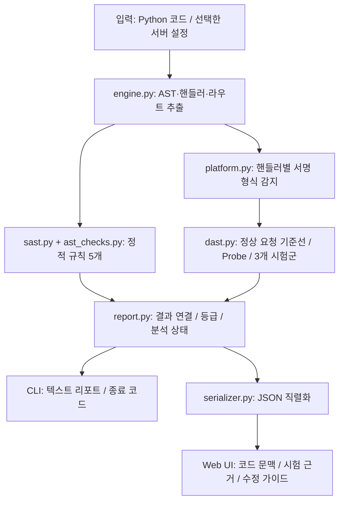

# HookLens — 웹훅 핸들러 보안 취약점 자동 탐지 프레임워크

웹훅 수신 서버 개발자가 **배포 전** 자신의 Python 핸들러 코드를 자가 점검할 수 있도록 설계된 **SAST + DAST 하이브리드 보안 분석 도구**입니다.

Python 소스코드를 AST로 분석하는 **정적 분석 5개 규칙**과, 별도로 실행 중인 테스트 서버에 요청을 보내는 **동적 분석 3개 시험군**을 결합합니다. 엔드포인트별 위험 징후, 동적 처리 증거, 수정 참고 코드와 관련 문서를 Web UI 및 CLI로 제공합니다.

업로드된 소스코드는 import하거나 실행하지 않고 AST로 읽습니다. DAST는 사용자가 실행한 수신 서버에 HTTP 요청을 보냅니다.

> 분석 결과는 지원하는 패턴과 시험 조건 안에서 해석해야 합니다. A 등급은 **점검 범위 내 미탐지**를 뜻하며, 애플리케이션 전체의 안전성을 보증하지 않습니다.

상세 변경 내용과 수정 전후 예시는 [코드 보완 설명](docs/CODE_CHANGES.md), 화면 구성과 시연 순서는 [UI 개편 설명](docs/UI_CHANGES.md)을 참고하세요.

## 목차

- [실행 환경](#실행-환경)
- [프로젝트 구조](#프로젝트-구조)
- [시연 가이드 (Web UI)](#시연-가이드-web-ui)
- [시연 서버별 실행 및 설정](#시연-서버별-실행-및-설정)
- [테스트](#테스트)
- [파일별 역할 상세 설명](#파일별-역할-상세-설명)
- [동적 분석 결과 해석](#동적-분석-결과-해석)
- [상태 조회 인터페이스 (Tier 1)](#상태-조회-인터페이스-tier-1)
- [플랫폼 지원 범위](#플랫폼-지원-범위)
- [분석 파이프라인 흐름](#분석-파이프라인-흐름)
- [현재 제한 사항](#현재-제한-사항)
- [실행 방법 요약](#실행-방법-요약)

---

## 실행 환경

- **기존 개발·시연 환경**: Ubuntu 22.04, VMware Workstation Pro 기반 가상환경
- **Python**: 3.10 이상
- **실행 방식**: 가상환경(venv) 기반
- **주요 의존성**: FastAPI, Uvicorn, Requests 등 — 설치 버전은 `requirements.txt` 기준
- **선택적 테스트 의존성**: 실제 ASGI/HTTP 검사용 `httpx`, 프런트엔드 JavaScript 검사용 Node.js

프로젝트 압축을 해제한 뒤 **`requirements.txt`와 `app.py`가 있는 디렉터리**에서 실행합니다.

```bash
python3 -m venv .venv
source .venv/bin/activate
python -m pip install -r requirements.txt
```

Windows PowerShell에서는 가상환경을 다음과 같이 활성화합니다.

```powershell
python -m venv .venv
.\.venv\Scripts\Activate.ps1
python -m pip install -r requirements.txt
```

이 문서의 `\`로 줄을 나눈 명령은 Bash 기준입니다. PowerShell에서는 명령을 한 줄로 입력할 수 있습니다.

---

## 프로젝트 구조

```text
webhook-analyzer-main/
├── README.md
├── main.py                        # CLI 진입점
├── app.py                         # Web UI / REST API 서버 (FastAPI)
├── run_exhibition.py              # 분석 UI + 시연 서버 일괄 실행
├── requirements.txt
├── EXHIBITION_DEMOS.md            # 추가 시연 서버·쇼핑몰 사용 안내
│
├── analyzer/                      # 핵심 분석 패키지
│   ├── engine.py                  # AST 파싱 + 핸들러·라우트·import 추출
│   ├── ast_checks.py              # 제한적 함수 호출 추적 + 검증 조건 확인
│   ├── sast.py                    # 정적 분석 — WHSEC-001~005
│   ├── dast.py                    # 동적 분석 — Probe + 3개 시험군
│   ├── platform.py                # 플랫폼·서명 형식 감지 + 참고 링크
│   ├── report.py                  # 결과 연결 + 위험 등급 + 통합 리포트
│   ├── serializer.py              # 결과 객체 → JSON 변환
│   └── __init__.py
│
├── backend/
│   ├── upload.py                  # .py / .zip 업로드 + 임시 폴더 관리
│   └── __init__.py
│
├── frontend/
│   └── index.html                 # 입력·결과 화면을 제공하는 단일 파일 SPA
│
├── server/
│   ├── test_server.py             # 취약 / 방어 패턴 테스트 수신 서버
│   └── __init__.py
│
├── samples/
│   ├── shop_server.py             # 주 시연: 단국 굿즈샵 — 토스 서명 형식
│   ├── stripe_demo_server.py      # Stripe 형식 — 취약 / 보완 경로 비교
│   ├── slack_demo_server.py       # Slack 형식 — 팀 굿즈 주문 알림 비교
│   ├── generic_shop_server.py     # 선택 시연: 사용자 정의 HMAC 형식
│   ├── demo_ui.py                 # 공통 쇼핑몰·모의 결제·웹훅 전송 기능
│   ├── demo_web/                  # 쇼핑몰 HTML·CSS·JavaScript·상품 이미지
│   ├── vulnerable_webhook.py      # SAST 규칙 검증용 취약 핸들러
│   ├── secure_webhook.py          # 지원하는 방어 패턴의 미탐지 확인용 예제
│   ├── utils_vulnerable.py        # 외부 파일 위임 결함 예제
│   └── vulnerable_zip/
│       ├── vulnerable_shop_server.py
│       └── webhook_utils.py       # ZIP 업로드·외부 함수 추적 시연용
│
├── tests/
│   ├── test_integration.py        # SAST → DAST → 등급 결정 통합 테스트
│   ├── test_regressions.py        # 정적·동적 판정, 서명, 등급, 업로드 회귀 검사
│   ├── test_api_pipeline.py       # API 분석 함수·다중 파일·코드 문맥 검사
│   ├── test_http_api.py           # 실제 ASGI·multipart·샘플 수신 서버 검사
│   ├── test_cli.py                # CLI 입력 검증·종료 코드 검사
│   ├── test_toss_shop.py          # 토스 서명·다중 서명·기본 쇼핑몰 회귀 검사
│   ├── test_exhibition_demos.py   # Stripe·Slack 취약 / 보완 경로 검사
│   ├── test_storefronts.py        # 네 쇼핑몰의 주문·모의 결제·상태 변경 검사
│   ├── check_frontend.cjs         # JavaScript 렌더링·입력·결과 표시 검사
│   ├── check_storefront.cjs       # 쇼핑몰 장바구니·결제·시험 조작 검사
│   └── __init__.py
│
└── docs/
    ├── CODE_CHANGES.md            # 코드 보완 내용·근거·검증 기록
    ├── UI_CHANGES.md              # 화면 구성·변경 내용·시연 순서
    ├── verification/             # 기존 검증 로그·요약
    └── *.patch                    # 코드·UI·명칭 등 변경 내역
```

---

## 시연 가이드 (Web UI)

브라우저에서 정적·동적 분석을 함께 확인하는 방법입니다. **터미널 2개**가 필요합니다.

### 1단계 — 시연 대상 서버 실행

```bash
# 터미널 1
python -m uvicorn samples.shop_server:app --port 8000 --reload
```

단국 굿즈샵 모의 서버가 `http://127.0.0.1:8000`에서 실행됩니다.

이 샘플은 **토스페이먼츠 웹훅 서명 형식을 구현한 로컬 모의 결제 서버**입니다. `TossPayments-Webhook-Signature`와 전송 시간 헤더를 사용하며, 실제 토스페이먼츠 결제 API에는 연결하지 않습니다. 상품 선택·장바구니·주문·모의 결제를 쇼핑몰 화면에서 진행할 수 있습니다.

### 2단계 — HookLens 서버 실행

```bash
# 터미널 2
python -m uvicorn app:app --port 8001 --reload
```

### 3단계 — 브라우저에서 분석 실행

`http://127.0.0.1:8001`에 접속해 `samples/shop_server.py`를 선택하고 **정적 + 동적 분석**을 실행합니다.

| 항목 | 입력값 |
|---|---|
| 소스코드 파일 | `samples/shop_server.py` |
| 웹훅 URL | `http://127.0.0.1:8000` |
| 시크릿 키 | `dku-toss-secret-2026` |
| 상태 생성 경로 | `/orders` |
| 상태 조회 경로 | `/orders/{id}` |
| 타임스탬프 허용 시간 | `300`초 |
| JSON 객체 전용 정책 | 기본 시연에서는 선택하지 않음 |

**시연 설정** 버튼을 누르면 위 설정값이 채워집니다. 파일 선택, 수신 서버 실행, 분석 시작은 별도로 진행해야 합니다.

실행 중인 서버와 **같은 프로젝트 폴더의 소스 파일**을 업로드하세요. 예전 일반 HMAC 버전의 `shop_server.py`를 현재 토스 형식 서버와 함께 사용하면 서명 형식이 달라 정상 요청도 실패할 수 있습니다. 다른 서버를 분석할 때는 아래 [서버별 설정표](#시연-서버별-실행-및-설정)에 맞춰 파일·URL·시크릿을 함께 변경합니다.

> 시크릿 키는 샘플의 `dku-toss-secret-2026`과 일치해야 합니다. 다른 키를 입력하면 정상 서명 기준 요청이 실패하고 동적 시험은 `inconclusive`로 표시됩니다. 키를 비우면 정상 서명이 필요한 시험은 `skipped`로 표시됩니다. 이 값은 공개된 시연용 예시 키입니다.

### 4단계 — 결과 확인

- **정적 분석**: 서명 일반 비교 사용(WHSEC-002, HIGH), 수신 시간값 검증 누락(WHSEC-004, MEDIUM)을 확인합니다.
- **동적 시험**: 정상 서명 기준 요청의 성공 여부, 만료 요청 수락과 해당 시험 주문의 상태 변경 여부를 확인합니다.
- **수정 가이드**: 탐지 위치의 주변 코드, 수정 참고 코드, 관련 문서를 확인합니다.
- **내보내기**: JSON 다운로드 또는 전체 결과 인쇄를 사용할 수 있습니다.

현재 `shop_server.py`의 기본 시연에서는 **토스페이먼츠로 감지**, 서명 누락·잘못된 서명은 **HTTP 401**, 정상 서명 기준은 **HTTP 200**이 예상됩니다. 정적 위험 징후는 2건이고, 동적 시험에서는 만료 요청의 처리 증거 1건을 확인합니다. 동적 시험 탭의 하위 시험 6건은 서로 다른 요청 변형의 수이며, 취약 처리 증거가 6건이라는 뜻은 아닙니다.

WHSEC-002는 일반 비교 패턴을 정적으로 탐지한 결과입니다. 현재 DAST에는 네트워크 시간 측정으로 시크릿을 복구하는 타이밍 공격 시험이 없습니다.

### 정적 분석만 실행하려면

UI에서 **정적 분석만**을 선택합니다. API는 `sast_only=true`이거나 웹훅 URL이 비어 있으면 DAST를 수행하지 않습니다. 수신 서버나 시크릿 없이도 코드를 점검할 수 있습니다.

---

## 시연 서버별 실행 및 설정

**기본 시연은 `shop_server.py`**를 사용합니다. Stripe·Slack은 서명 형식과 보완 전후 차이를 보여주는 추가 시연이고, Generic은 사용자 정의 HMAC을 비교할 때 선택합니다. 시연 대상은 총 4개이며 HookLens 분석 UI는 별도 서버입니다.

### 실행 명령

모든 명령은 프로젝트 루트에서 실행합니다. 필요한 서버만 개별 실행하거나, 다음 명령으로 분석 UI와 네 시연 서버를 한 번에 실행할 수 있습니다.

```bash
python run_exhibition.py

# Generic을 제외하고 분석 UI + 토스·Stripe·Slack만 실행
python run_exhibition.py --without-generic
```

두 명령 중 하나를 선택합니다. 일괄 실행은 `Ctrl+C`로 함께 종료하며, 사용할 포트가 이미 점유되어 있으면 시작하지 않습니다. 개별 실행해 둔 서버가 있다면 종료한 뒤 사용하세요.

| 대상 / 업로드할 소스 파일 | 개별 실행 명령 |
|---|---|
| 기본 · `samples/shop_server.py` | `python -m uvicorn samples.shop_server:app --port 8000` |
| Stripe · `samples/stripe_demo_server.py` | `python -m uvicorn samples.stripe_demo_server:app --port 8002` |
| Slack · `samples/slack_demo_server.py` | `python -m uvicorn samples.slack_demo_server:app --port 8003` |
| Generic · `samples/generic_shop_server.py` | `python -m uvicorn samples.generic_shop_server:app --port 8004` |
| HookLens 분석 UI · 업로드 대상 아님 | `python -m uvicorn app:app --port 8001` |

### 분석 입력값과 웹훅 경로

| 시연 대상 | 쇼핑몰 주소 / 분석에 입력할 웹훅 URL | 시크릿 키 | 취약 예제 웹훅 경로 |
|---|---|---|---|
| 토스 · DKU GOODS | `http://127.0.0.1:8000` | `dku-toss-secret-2026` | `/webhook/toss-payment` |
| Stripe · FORM & FIELD | `http://127.0.0.1:8002` | `stripe-demo-secret-2026` | `/webhook/stripe` |
| Slack · COMMON TEAM | `http://127.0.0.1:8003` | `slack-demo-secret-2026` | `/webhook/slack` |
| Generic · NEIGHBOR STORE | `http://127.0.0.1:8004` | `generic-demo-secret-2026` | `/webhook/generic-payment` |

분석 URL에는 **포트까지의 기본 주소**를 입력합니다. 웹훅 경로는 업로드한 코드에서 추출합니다. 표의 키는 각 파일의 `WEBHOOK_SECRET`에 있는 공개된 로컬 시연용 값입니다.

| 공통 설정 | 입력값 / 의미 |
|---|---|
| 상태 생성 경로 | `/orders` |
| 상태 조회 경로 | `/orders/{id}` — 실제 서버 인자는 `order_id`이며 분석기에는 `{id}`로 입력 |
| 타임스탬프 허용 시간 | `300`초 — 기본 만료 시험은 360초 전 요청 |
| JSON 객체 전용 정책 | 기본 시연에서는 선택하지 않음 |

Stripe에는 `/webhook/stripe-fixed`, Slack에는 `/webhook/slack-fixed` 보완 경로가 같은 서버 안에 있습니다. 해당 소스 파일을 분석하면 취약·보완 경로를 함께 확인할 수 있습니다. 보완 경로는 정상 서명을 수락하고 허용 시간을 벗어난 요청을 거부하도록 구성했습니다.

### 서버별 예상 결과

현재 샘플과 기본 허용 시간 300초를 기준으로 합니다. 만료 요청은 **360초 전 시간값을 포함해 올바른 시크릿으로 서명한 요청**이며, 각 요청은 연결된 새 시험 주문을 사용합니다. 모든 경로에서 정상 서명 요청은 HTTP 200, 서명 누락·잘못된 서명은 HTTP 401이 예상됩니다.

| 대상 / 경로 | 정적 분석 예상 | 만료 요청의 응답·주문 상태 |
|---|---|---|
| 토스 · `/webhook/toss-payment` | WHSEC-002 / HIGH, WHSEC-004 / MEDIUM | HTTP 200 · `paid`로 변경 |
| Stripe · `/webhook/stripe` | WHSEC-004 / MEDIUM | HTTP 200 · `paid`로 변경 |
| Stripe 보완 · `/webhook/stripe-fixed` | 위험 징후 미탐지 | HTTP 401 · `pending` 유지 |
| Slack · `/webhook/slack` | WHSEC-002 / HIGH, WHSEC-004 / MEDIUM | HTTP 200 · 알림 처리 상태가 `processed`로 변경 |
| Slack 보완 · `/webhook/slack-fixed` | 위험 징후 미탐지 | HTTP 401 · `pending` 유지 |
| Generic · `/webhook/generic-payment` | WHSEC-002 / HIGH, WHSEC-004 / MEDIUM | HTTP 200 · `paid`로 변경 |

Stripe·Slack 파일은 취약·보완 경로를 함께 포함하므로 **보완 경로가 정상이어도 파일 전체가 A 등급이 되지는 않습니다.** 엔드포인트를 선택해 각 경로의 결과를 비교하세요. 일반 서명 비교의 정적 탐지는 타이밍 공격 성공을 입증한 결과와 구분합니다.

### 쇼핑몰에서 직접 확인하기

각 주소에서 상품을 장바구니에 담고 시연용 주문자·배송 정보를 입력한 뒤 모의 결제를 진행합니다. 실제 계정이나 카드 정보는 필요하지 않습니다. 상품 가격과 배송비는 서버에서 계산하고, 모의 결제·시험 전송은 같은 서버의 웹훅 핸들러를 호출해 처리 결과를 표시합니다.

시험 콘솔에서 새 시험 주문을 만든 뒤 정상·만료·잘못된 서명·서명 누락 요청을 비교할 수 있습니다. Stripe·Slack은 보완 경로도 선택할 수 있습니다. Slack 시연의 서명 검증 대상은 **주문 알림 이벤트**이며, 알림 수신을 실제 결제 승인으로 취급하지 않습니다.

`GET /demo/state`가 약 2.5초 간격으로 기록되는 것은 화면의 주문·시험 결과를 갱신하는 조회입니다. 이 요청 자체가 주문이나 결제를 반복 생성하지는 않습니다. 주문 상태는 메모리에 보관하므로 서버를 재시작하면 초기화됩니다.

자세한 시연 순서는 [추가 시연 안내](EXHIBITION_DEMOS.md)를 참고하세요.

### 시연 중 문제 확인

| 상황 | 확인할 내용 / 조치 |
|---|---|
| 정상 서명 기준 요청도 HTTP 401 | 업로드 파일·수신 서버가 같은 버전인지, 해당 서버의 시크릿·URL을 입력했는지 확인 |
| 서버에 연결되지 않음 | 수신 서버 실행 여부와 포트 확인. 분석 UI의 8001이 아닌 시연 대상의 포트를 입력 |
| 상태 조회가 되지 않거나 Tier 2로 표시 | 상태 생성 `/orders`, 조회 `/orders/{id}` 설정과 해당 서버의 상태 API 응답 확인 |
| 쇼핑몰에서 재시험 시 HTTP 409 | 이미 처리한 주문이므로 시험 콘솔의 **매번 새 시험 주문 사용**을 선택해 다시 전송 |
| 외부 함수 소스 미확인 INFO | 보조 Python 파일을 같은 폴더 구조로 포함한 ZIP을 업로드 |

---

## 테스트

### 전체 파이프라인 통합 테스트

전체 파이프라인(SAST → DAST → 등급 결정)의 동작을 자동으로 검증합니다. **서버를 미리 실행할 필요가 없습니다.** 테스트 수신 서버는 사용 가능한 로컬 포트로 자동 기동되고, 검사가 끝나면 종료됩니다.

```bash
python tests/test_integration.py
```

다음 항목을 순서대로 검증합니다.

1. **SAST 규칙** — 취약 예제에서 WHSEC-001~005 탐지와 수정 참고 코드 생성을 확인합니다.
2. **방어 패턴 예제** — `secure_webhook.py`에서 INFO를 제외한 위험 징후가 없는지 확인합니다. 이 예제에 대한 결과이며 모든 코드의 오탐 부재를 뜻하지 않습니다.
3. **Probe** — 핵심 6개 엔드포인트의 상태 조회 가능 여부와 Tier 분류를 확인합니다.
4. **DAST 3개 시험군** — 서명 정책, 재전송, 입력 형식 시험의 처리 증거 및 거부 상태를 확인합니다.
5. **플랫폼별 검증** — Stripe, 토스페이먼츠, Slack, PortOne V2 모의 엔드포인트를 확인합니다.
6. **통합 리포트** — CRITICAL 징후에 따른 F 등급, SAST 7건 이상, DAST 처리 증거 4건 이상을 확인합니다.

모든 단계 통과 시 `🎉 전체 파이프라인 통과!`가 출력되고 종료 코드 0을 반환합니다.

### 테스트 파일과 확인 범위

| 파일 | 확인 범위 |
|---|---|
| `tests/test_integration.py` | 예제 SAST → 자동 기동한 수신 서버 → Probe·DAST → 통합 등급을 연결하는 전체 파이프라인 |
| `tests/test_regressions.py` | 검증 분기·해시 별칭·다중 서명 등 정적 분석 반례, 동적 판정, 플랫폼 서명, 등급, ZIP 처리 |
| `tests/test_api_pipeline.py` | 분석 API 함수의 다중 파일·외부 함수 결과 연결·핸들러별 플랫폼·원본 코드 문맥 |
| `tests/test_http_api.py` | 실제 ASGI·multipart·ZIP 업로드와 Uvicorn 수신 서버, 정상 키·잘못된 키 분석 |
| `tests/test_cli.py` | CLI 입력 오류와 분석 결과에 따른 종료 코드 |
| `tests/test_toss_shop.py` | 토스 정상·다중 서명, 누락·변조·기존 Generic 서명 거부, 의도한 만료 검사 누락, 플랫폼 감지·수정 예제 |
| `tests/test_exhibition_demos.py` | Stripe·Slack의 정상·변조·만료·미래 요청, 보완 경로의 거부, 실제 수신 서버와 업로드 소스의 분석 결과 일치 |
| `tests/test_storefronts.py` | 네 쇼핑몰의 화면·자산, 서버 가격 계산·입력 검증, 모의 결제와 실제 핸들러 상태 변경, 중복 결제·금액 불일치 거부 |
| `tests/check_frontend.cjs` | 분석 UI의 JavaScript 렌더링·입력 검증·결과 상태·escaping·출력 |
| `tests/check_storefront.cjs` | 쇼핑몰 JavaScript의 상품·장바구니·주문·모의 결제·시험 조작과 보완 경로 선택 |

### 단위·회귀·HTTP·프런트엔드 검사

```bash
# 아래 Python 검사 전체 실행에 필요한 테스트 의존성
python -m pip install httpx

# Python 단위·회귀·API·CLI 검사
python -m unittest discover -s tests -v

# 선택 사항: Node.js가 설치되어 있을 때 실행
node tests/check_frontend.cjs
node tests/check_storefront.cjs
```

- Python 단위·회귀 테스트는 표준 `unittest`를 사용합니다. `test_integration.py`는 위의 별도 명령으로 실행하며 `unittest discover`만으로 실행되지 않습니다.
- 추가된 쇼핑몰·서명 테스트는 FastAPI `TestClient`를 사용하므로 프로젝트 의존성과 `httpx`를 먼저 설치합니다. `test_http_api.py` 자체는 의존성이 없을 때 검사를 생략하도록 되어 있습니다.
- `test_api_pipeline.py`는 FastAPI가 없으면 선언 인터페이스 대역으로 분석 함수를 검사합니다. 이 방식은 실제 ASGI/HTTP 라우팅 검증을 대신하지 않습니다.
- 두 Node.js 검사는 DOM 대역으로 JavaScript 동작을 확인합니다. 실제 브라우저의 배치·시각적 완성도 검사는 별도로 진행해야 합니다. Node.js는 이 검사에만 필요하며 HookLens 자체 실행에는 필요하지 않습니다.
- ZIP에 포함된 과거 검증 결과와 실행 환경은 `docs/CODE_CHANGES.md`, `docs/UI_CHANGES.md`, `docs/verification/`에 기록되어 있습니다.

시연 서버 관련 검사만 골라 실행하려면 다음 명령을 사용합니다.

```bash
python -m unittest tests.test_toss_shop tests.test_exhibition_demos tests.test_storefronts -v
```

---

## 파일별 역할 상세 설명

### 진입점

#### `main.py`

**CLI 진입점.** 터미널에서 Python 파일을 지정해 분석을 실행합니다.

- `argparse`로 코드 경로, 서버 URL, 시크릿, 상태 API 경로와 분석 옵션을 처리합니다.
- AST 파싱, 플랫폼 감지, SAST, DAST, 통합 리포트 생성을 연결합니다.
- 핸들러별 감지 결과에 맞춰 DAST 서명 설정을 적용합니다.
- 종료 코드로 탐지 결과와 분석 미완료를 구분해 CI/CD에서 활용할 수 있습니다.
- CLI의 `--code` 입력은 Python 파일 경로입니다. ZIP 업로드는 Web UI/API에서 처리합니다.

```bash
# SAST + DAST 통합 분석
python main.py \
    --code samples/shop_server.py \
    --url http://127.0.0.1:8000 \
    --secret dku-toss-secret-2026 \
    --state-create /orders \
    --state-query '/orders/{id}'

# SAST만 실행
python main.py --code samples/vulnerable_webhook.py --sast-only
```

**주요 CLI 옵션:**

| 옵션 | 설명 / 기본값 |
|---|---|
| `--code FILE` | 분석할 Python 파일. 필수 |
| `--url URL` | 수신 서버 기본 URL. DAST 실행 시 필요 |
| `--secret SECRET` | 정상 서명 생성용 시크릿. 미입력 시 관련 시험 생략 |
| `--state-create PATH` | 상태 생성 경로. CLI 기본값 `/orders` |
| `--state-query TEMPLATE` | 상태 조회 경로. CLI 기본값 `/orders/{id}` |
| `--timeout SECONDS` | 요청 제한 시간. 기본값 `5.0`초 |
| `--sast-only` | 정적 분석만 수행 |
| `--dast-only` | 정적 규칙 검사를 생략하고 동적 분석 수행. 코드 파싱은 필요 |
| `--endpoint PATH` | DAST 대상 경로 직접 지정. 여러 번 사용 가능 |
| `--timestamp-tolerance SECONDS` | 대상 서버의 실제 허용 시간. 기본값 `300`초 |
| `--strict-json` | 대상의 JSON 객체 전용 정책을 명시하고 입력 정책 위반 평가 |

`--sast-only`와 `--dast-only`는 동시에 사용할 수 없습니다. 서버 URL은 인증정보·쿼리·fragment가 없는 HTTP(S) 기본 URL이어야 합니다. UI/API의 상태 경로는 기본적으로 비어 있으므로 Tier 1 시연 시 두 경로를 입력해야 합니다.

| 종료 코드 | 의미 |
|---|---|
| `0` | 실행한 점검 범위에서 위험 징후·처리 증거 미탐지 |
| `1` | 정적 위험 징후 또는 동적 처리 증거 탐지. 부분 분석이어도 탐지가 있으면 우선 반환 |
| `2` | 입력 오류, 분석 대상 없음 또는 탐지 없이 분석 미완료 |

#### `app.py`

**Web UI / REST API 서버.** FastAPI 기반으로 파일을 받아 분석하고 JSON 결과를 반환합니다.

| 경로 | 역할 |
|---|---|
| `GET /` | `frontend/index.html` 제공 |
| `GET /health` | 서버 상태·버전·플랫폼 감지 모듈 사용 가능 여부 반환 |
| `POST /analyze` | `.py` / `.zip` 업로드 및 정적·동적 분석 |

- ZIP에서 추출한 여러 Python 파일을 분석하고, 업로드 루트를 기준으로 외부 함수 소스를 찾습니다.
- 엔드포인트별 플랫폼 설정과 Probe 결과를 포함합니다.
- 외부 함수 결함을 호출한 원래 핸들러에 연결하고, 파일·줄 위치와 주변 원본 코드 문맥을 제공합니다.
- 파싱 오류, 라우터 분리, 중복 경로 등 분석 제한을 응답에 표시합니다.
- DAST 세션과 업로드 임시 폴더는 처리가 끝나면 정리합니다.

`POST /analyze`는 multipart/form-data로 `code`, `webhook_url`, `secret`, `state_create`, `state_query`, `sast_only`, `strict_json`, `timestamp_tolerance`를 받습니다. `code`는 필수이며, API의 허용 시간 범위는 1~86,400초입니다.

```bash
uvicorn app:app --reload --port 8001
```

### `analyzer/` — 핵심 분석 패키지

#### `analyzer/engine.py`

**AST 파서 + 핸들러·라우트 추출 엔진.** 다른 분석 모듈이 사용하는 기본 정보를 생성합니다.

- `ast.parse()`로 Python 코드를 파싱해 함수, import, 웹훅 핸들러, 라우트를 추출합니다.
- 지원하는 라우트 데코레이터가 있는 함수에서 경로 키워드(`webhook`, `hook`, `callback`, `notify`, `event`), 서명 파라미터명 또는 지원하는 서명 헤더 읽기 패턴으로 핸들러를 찾습니다.
- FastAPI `Header(alias=...)`와 keyword-only 헤더 인자 등 일부 패턴을 인식합니다.
- `resolve_import()`는 상대·절대 import를 프로젝트 경계 안의 `.py` 파일 또는 패키지 `__init__.py`로 해석합니다. 대상 모듈을 실행하지 않습니다.
- `_detect_router_split()`은 `include_router()` 등 라우터 분리 패턴을 감지해 추가 확인에 사용합니다. 라우터 prefix와 등록 관계를 자동으로 합성하지는 않습니다.
- 소스 읽기·구문 오류는 `ParseResult.errors`에 기록합니다.

**주요 데이터 클래스:**

| 클래스 | 설명 |
|---|---|
| `ParseResult` | AST, 핸들러, 함수, import, 라우트, 원본 소스, 파싱 오류 |
| `WebhookHandler` | 핸들러의 함수명·경로·메서드·줄 위치 |
| `RouteEndpoint` | 라우트의 HTTP 메서드·경로·경로 파라미터·헤더 정보 |
| `FunctionInfo` | 추적 가능한 함수 정보 |
| `ImportInfo` | import 경로·이름·별칭·상대 import 수준 |
| `HeaderParam` | Python 인자와 실제 HTTP 헤더의 연결 정보 |

#### `analyzer/ast_checks.py`

**정적 분석 공통 보조 모듈.** 기존 5개 보안 규칙의 판정을 지원합니다.

- import 별칭을 정규화하고, 호출한 함수의 소스를 제한적으로 추적합니다.
- HMAC 계산이나 `verify`라는 함수명만으로 검증이 있다고 인정하지 않고, 지원하는 비교 결과와 실패 거부·반환 분기의 연결을 확인합니다.
- 수신 시간값과 현재 시각의 비교 및 처리 분기를 확인합니다.
- 동일 파일 함수 호출은 최대 4단계, 외부 파일은 1단계 범위로 추적하고 순환 호출의 중복 방문을 중단합니다.

임의의 Python 프로그램 전체에 대한 데이터 흐름이나 모든 실행 경로를 증명하는 분석기는 아닙니다.

#### `analyzer/sast.py`

**정적 분석(SAST) 엔진.** `ParseResult`에 5개 규칙을 적용해 `Finding`을 생성합니다.

| 규칙 ID | 점검 내용 | 위험 등급 | 해석 |
|---|---|---|---|
| WHSEC-001 | 서명 검증 누락 또는 검증 확인 불가 | CRITICAL, 추적 불가 시 INFO | 서명 비교 결과로 처리를 제한하는 지원 패턴을 찾는지 확인 |
| WHSEC-002 | 서명 일반 비교 사용 | HIGH | 서명 관련 값의 `==`·`!=` 비교를 탐지하고 `hmac.compare_digest` 사용 권고 |
| WHSEC-003 | 레거시 HMAC 알고리즘 | MEDIUM | HMAC-SHA1·MD5 사용 탐지 및 SHA256 전환 정책 검토 |
| WHSEC-004 | 수신 시간값 검증 누락 | MEDIUM | 서명·시간값 수신 패턴이 있을 때 만료 검사 여부 확인 |
| WHSEC-005 | 외부 검증 함수 내부 결함 / 소스 미확인 | 내부 결함에 따라 HIGH·MEDIUM, 추적 불가 시 INFO | 외부 함수의 일반 비교·레거시 HMAC 결함을 추적 |

- 수정 권고(`recommendation`)와 수정 참고 코드(`fix_snippet`)를 제공합니다. 추적 불가 INFO에는 코드 예제가 없을 수 있습니다.
- `==`와 `!=`의 기존 분기 의미를 유지하는 비교 수정 예제를 생성합니다.
- 해시 위치·키워드 인자, 문자열 알고리즘, import 별칭 등 지원 패턴을 처리합니다.
- WHSEC-005는 외부 함수에 위임했다는 사실 자체를 취약점으로 보지 않습니다. 확인한 내부 결함과 추적 불가 안내를 구분합니다.
- 동적 import 안내 `WHSEC-DYN`은 보조 INFO이며 여섯 번째 보안 규칙이 아닙니다.
- 규칙은 공통으로 적용하지만, 실제 방어 요구와 수정 방식은 플랫폼별 명세를 함께 확인해야 합니다.

이 문서는 숫자 점수 대신 **위험 등급과 확인된 근거**로 결과를 설명합니다. INFO는 추가 확인 안내이며 취약점 확정을 뜻하지 않습니다. HMAC-MD5 사용 탐지만으로 실제 서명 위조 성공을 입증한 것으로 해석하지 않습니다.

#### `analyzer/dast.py`

**동적 분석(DAST) 엔진.** 실제 수신 서버에 HTTP 요청을 보내 응답과 처리 효과를 관측합니다.

**Probe — 4단계:**

| 단계 | 확인 내용 |
|---|---|
| Step 1 | 서명 없이 전송해 수락 여부 확인 |
| Step 2 | 잘못된 시크릿으로 만든 서명을 전송해 거부 여부 확인 |
| Step 3 | 유효한 서명 요청이 2xx로 응답하는지 확인해 정상 요청 기준선 수립 |
| Step 4 | 시험 주문 생성·상태 조회 가능 여부로 Tier 1 / Tier 2 결정 |

| Tier | 관측 범위 |
|---|---|
| **Tier 1** | 상태 생성·조회 API를 사용할 수 있어 시험 전후 상태 비교 가능 |
| **Tier 2** | HTTP 응답을 중심으로 관측. 2xx 수락만으로 취약 확정하지 않음 |

Tier는 수신 서버의 상태 API를 실제로 사용할 수 있는지에 따라 정합니다. 경로 입력 여부나 플랫폼 이름만으로 정하지 않으며, Tier 1 자체가 취약 확정을 뜻하지 않습니다.

**3개 시험군:**

| 시험군 | 내용 | 판정 시 고려 사항 |
|---|---|---|
| 다운그레이드 / 서명 정책 | 일반 HMAC·GitHub 형식은 SHA1·MD5·서명 누락, 나머지 지원 플랫폼은 잘못된 서명·서명 누락 시험 | GitHub 레거시 SHA1 헤더 수락은 정책 검토가 필요하므로 관측으로 보고 |
| 재전송 | 대상 허용 시간보다 60초 오래된 시간값과 유효 서명 전송. 가능한 프로토콜은 본문·서명을 유지한 시간 헤더 갱신도 시험 | 기본 허용 시간 300초이면 360초 전 요청. GitHub 시간 기반 시험은 생략하며 전달 ID 중복 방지는 별도 범위 |
| 타입 혼동 / 입력 정책 | Content-Type을 `text/plain`으로 변경(Stage A), JSON 본문을 배열로 래핑(Stage B) | 유효한 서명으로 입력 정책을 시험. 기본은 수락 관측이며 JSON 객체 전용 계약이 있을 때 `--strict-json` 적용 |

시험별 요청 변형은 여러 개일 수 있으므로, 결과 건수와 시험군 3개의 개수는 다릅니다. 각 요청은 관련 규칙 ID와 변형명(`variant`), HTTP 코드, 상태 변경 여부를 함께 기록합니다.

정상 서명 기준 요청이 실패하면 시험 요청의 거부를 정상 방어로 판정하지 않습니다. 5xx·429·리다이렉트·연결 오류 등은 판단 불가로 구분합니다. 결과 상태의 상세 의미는 아래 [동적 분석 결과 해석](#동적-분석-결과-해석)을 참고하세요.

#### `analyzer/platform.py`

**플랫폼 자동 감지 모듈.** 코드에서 플랫폼과 DAST용 서명 헤더·형식을 추정합니다.

**기본 감지 우선순위:**

1. **파라미터명** — `stripe_signature`, `x_hub_signature_256` 등 지원하는 이름. 신뢰도 `high`
2. **문자열 패턴** — 소스 내 플랫폼·서명 관련 문자열. 신뢰도 `medium`
3. **Generic / Unknown** — 일반 서명 헤더 추출 또는 감지 실패. 신뢰도 `low`

- `detect_per_handler()`는 각 핸들러를 분리해 감지하고, 지원하는 `request.headers.get(...)`와 `Header(alias=...)`의 실제 헤더명을 반영합니다.
- 지원 분류는 `GitHub`, `Stripe`, `토스페이먼츠`, `Slack`, `PortOne V2`, `Generic`, `Unknown`입니다.
- `PLATFORM_DOC_LINKS`와 `RULE_DOC_LINKS`에 플랫폼·규칙별 참고 링크를 보관합니다.

플랫폼 감지 신뢰도는 코드 패턴 추정 수준이며, 동적 취약 판정 신뢰도와는 별개입니다. 생성하는 서명 형식과 적용 범위는 아래 [플랫폼 지원 범위](#플랫폼-지원-범위)를 참고하세요.

#### `analyzer/report.py`

**결과 연결 + 통합 등급 결정 + 리포트 생성.** 정적·동적 증거를 엔드포인트별로 합칩니다.

- `group_findings()`는 외부 결함의 실제 파일 위치와 원래 호출 핸들러 위치를 구분해 결과에 연결합니다.
- SAST의 가장 높은 심각도와 DAST에서 확인한 처리 증거를 등급에 반영합니다.
- 관련 규칙 ID가 겹칠 때만 같은 점검 항목의 정적·동적 교차 확인으로 표시합니다.
- `observed`, `inconclusive`, `skipped` 또는 INFO 안내가 남으면 부분 분석 상태를 표시합니다.
- 정적·동적 교차 확인은 증거의 연결로 표시하며, 중복 탐지를 별도의 가산점으로 해석하지 않습니다.
- DAST 단독 처리 증거도 위험 등급에 반영합니다. 등급과 함께 기준 요청의 성립 여부·상태 변경·미완료 항목을 확인해야 합니다.

**전체 등급 기준:**

| 등급 | 조건 / 의미 |
|---|---|
| F | CRITICAL 위험 징후 존재 — 즉시 검토 필요 |
| D | 최고 심각도 HIGH — 주요 위험 징후 |
| C | 최고 심각도 MEDIUM — 개선·검토 필요 |
| B | 최고 심각도 LOW — 경미한 위험 징후 |
| A | 실행한 점검 범위에서 미탐지, 추가 확인 항목 없음 |
| N/A | 분석 대상 없음 또는 위험 등급을 정할 탐지 없이 추가 확인 필요 |

탐지된 위험과 미완료 항목이 함께 있으면 위험 등급을 유지하고 `partial` 상태를 표시합니다. 정적 분석만 수행한 A 등급은 동적 방어 검증까지 통과했다는 뜻이 아닙니다.

**주요 데이터 클래스:**

| 클래스 | 설명 |
|---|---|
| `EndpointReport` | 한 엔드포인트의 SAST·DAST 결과, 위험 등급, 처리 증거, 분석 상태 |
| `FullReport` | 전체 등급, 정적 탐지·동적 처리 증거·관측·판단 불가·생략 건수 |

#### `analyzer/serializer.py`

**결과 객체 → JSON 직렬화.** Python `dataclass` 결과를 API 응답용 `dict`로 변환합니다.

| 함수 | 변환 대상 |
|---|---|
| `finding_to_dict()` | SAST `Finding` |
| `attack_result_to_dict()` | DAST `AttackResult` |
| `probe_result_to_dict()` | `ProbeResult` |
| `endpoint_report_to_dict()` | `EndpointReport` |
| `full_report_to_dict()` | 최종 `FullReport` |

기존 `vulnerable`, `cvss_score`, `overall_cvss` 키를 유지하면서 `status`, `variant`, `related_rule_ids`, `origin_filepath`, `analysis_status`, `score_basis` 등 결과 해석에 필요한 필드를 제공합니다. 원본 코드 문맥은 `app.py`에서 추가합니다.

### `backend/`

#### `backend/upload.py`

**파일 업로드 처리 + 임시 폴더 관리.** `.py` 또는 `.zip` 파일을 받아 분석용 Python 파일 목록을 반환합니다.

- 업로드 파일 크기: 최대 **10 MiB**
- ZIP 전체 항목 수: 최대 **2,000개**
- 실제 추출하는 Python 파일의 누적 해제 크기: 최대 **50 MiB**, **64 KiB** 청크 단위로 확인
- ZIP 경로의 `..`, 절대 경로, Windows 드라이브·역슬래시 경로, 심볼릭 링크 항목을 제외하고 추출 경계를 확인합니다.
- ZIP에서 `.py` 파일만 추출하며, `find_webhook_files()`는 `webhook`, `hook`, `handler`, `app`, `main`, `server` 등이 파일명에 있는 파일을 우선 정렬합니다.
- `cleanup()`은 분석 완료 후 임시 폴더를 삭제합니다.

이 제한은 업로드·해제 처리를 위한 것이며, 대규모 AST 분석의 CPU·메모리를 별도 샌드박스로 격리하는 기능은 아닙니다.

### `frontend/`

#### `frontend/index.html`

**웹 UI — 단일 파일 SPA.** HTML, CSS, JavaScript가 하나의 파일에 들어 있으며 별도 빌드 과정 없이 `app.py`가 제공합니다.

- 클릭·드래그 앤 드롭 파일 선택과 정적 + 동적 / 정적 분석만 모드 선택
- 시연 설정 자동 입력, 시크릿 표시 전환, 고급 설정의 상태 경로·허용 시간·JSON 객체 전용 정책
- 전체 등급·정적 위험 징후·동적 처리 증거·추가 확인·생략 요약
- 엔드포인트 검색·필터와 선택한 항목의 상세 화면

| 상세 탭 | 내용 |
|---|---|
| 분석 요약 | 정상 요청 기준 4단계, 정적 탐지, 동적 시험군 요약 |
| 정적 분석 | 규칙·파일·줄 위치, 주변 코드 문맥, 탐지 줄 강조 |
| 동적 시험 | 시험군·변형·판정 상태·HTTP 코드·Tier·실행 근거 |
| 수정 가이드 | 권고·수정 참고 코드·복사 버튼·관련 문서 |

- WHSEC-004 등 참고 안내에 감지된 플랫폼의 관련 문서를 반영합니다.
- 미완료·미확정 결과를 안전으로 바꾸지 않고, 정적 분석만 수행한 결과에는 동적 관측을 수행한 것처럼 표시하지 않습니다.
- 실제 API 응답 JSON을 다운로드하고 전체 엔드포인트의 결과·근거·가이드를 인쇄할 수 있습니다.
- 코드·파일명·실행 근거 등을 HTML escaping 후 표시하며 참고 문서 링크는 HTTP(S)만 허용합니다.

### `server/`

#### `server/test_server.py`

**테스트 전용 웹훅 수신 서버.** 통합 테스트에서 자동 기동하며, 단독 실행의 기본 포트는 9000입니다.

**의도적으로 결함을 포함한 엔드포인트:**

| 경로 | 시험 목적 |
|---|---|
| `POST /webhook/no-verify` | 서명 검증 누락 (WHSEC-001) |
| `POST /webhook/timing-attack` | 서명 일반 비교 예제 (WHSEC-002). 시간 검증도 누락 |
| `POST /webhook/delegated` | 동일 파일 위임 예제에 대응하는 수신 경로 |
| `POST /webhook/delegated-external` | 외부 파일 위임 예제에 대응하는 수신 경로 |
| `POST /webhook/weak-hash-sha1` | 정상 SHA256과 레거시 SHA1을 함께 허용하는 정책 결함 |
| `POST /webhook/weak-hash-md5` | 정상 SHA256과 레거시 MD5를 함께 허용하는 정책 결함 |
| `POST /webhook/no-timestamp` | 서명은 검사하지만 수신 시간 만료를 검사하지 않음 |
| `POST /webhook/stripe` | Stripe 형식 서명을 검사하지만 시간 만료 미검증 |
| `POST /webhook/toss` | 토스 형식 모의 이벤트의 서명 일반 비교 및 시간 만료 미검증 |
| `POST /webhook/slack` | Slack 형식 서명을 검사하지만 시간 만료 미검증 |
| `POST /webhook/portone` | 서명 헤더 존재만 검사하고 서명값은 검증하지 않음 |

**방어 패턴 및 상태 교차 검증 엔드포인트:**

| 경로 | 설명 |
|---|---|
| `POST /webhook/secure` | SHA256·`compare_digest`·서명된 본문 시간값·Content-Type·JSON 객체 검증 |
| `POST /orders` | 시험 주문 생성, `order_id` 반환 |
| `GET /orders/{id}` | 시험 주문 상태 조회 |

수신 서버 자체의 일반 HMAC 및 플랫폼별 시험 키는 통합 테스트 설정을 참고하세요. 쇼핑몰 시연용 키와 혼동하지 않아야 합니다.

### `samples/`

#### `samples/shop_server.py` — 주 시연 대상

**단국 굿즈샵 — 토스 서명 형식의 모의 결제 서버.** 개발자가 구현한 웹훅 핸들러를 배포 전에 점검하는 상황을 가정합니다.

상품·장바구니·주문·모의 결제 화면과 주문 상태 API를 제공합니다. `raw body + ':' + 전송 시간`을 HMAC-SHA256으로 서명하고, `TossPayments-Webhook-Signature: v1:<Base64>`를 검증합니다. 여러 서명 중 유효한 값이 있으면 수락하는 형태이며 실제 결제 제공자에는 연결하지 않습니다.

| 의도한 정적 탐지 | 내용 |
|---|---|
| WHSEC-002 / HIGH | 서명 비교에 `==` 사용. 타이밍 노출 가능성 검토 |
| WHSEC-004 / MEDIUM | `TossPayments-Webhook-Transmission-Time`을 서명에 포함하지만 만료 검사 미수행 |

Content-Type과 JSON 객체 여부를 검사하므로 기본 시연에서는 입력 형식 시험이 거부되고, 만료 요청의 처리 증거를 확인하는 데 활용할 수 있습니다.

#### `samples/stripe_demo_server.py`

**Stripe 서명 형식 비교 예제.** `Stripe-Signature`의 시간값과 본문을 함께 검증합니다. `/webhook/stripe`는 시간 만료 검사가 없고, `/webhook/stripe-fixed`는 `compare_digest`와 시간 검사를 적용합니다. 같은 서버에서 만료 요청의 수락·거부 차이를 보여줍니다.

#### `samples/slack_demo_server.py`

**Slack 주문 알림 수신 비교 예제.** `X-Slack-Signature`와 `X-Slack-Request-Timestamp`를 사용합니다. `/webhook/slack`에는 일반 서명 비교·만료 검사 누락이 있고, `/webhook/slack-fixed`는 두 부분을 보완합니다. 쇼핑몰 화면의 모의 결제와 알림 이벤트 처리는 구분해 표시합니다.

#### `samples/generic_shop_server.py`

**사용자 정의 HMAC 비교 예제.** `X-Signature: sha256=<hex>`로 본문만 서명하며, `X-Timestamp`를 서명에 묶거나 만료 검사에 사용하지 않습니다. 일반 서명 비교와 시간 검증 누락을 포함합니다. 기본 토스 시연과 별개로 일반 HMAC 형식을 비교할 때 사용합니다.

#### `samples/demo_ui.py` / `samples/demo_web/`

**네 시연 서버가 공유하는 쇼핑몰 기능과 화면 자산.** 서버별 상품·디자인을 적용하고, 장바구니 주문·서버 가격 계산·모의 결제·웹훅 시험 전송·결과 조회를 제공합니다. 시연용 서명 생성은 서버에서 수행합니다. 일괄 실행용 `run_exhibition.py`와 서버별 주소·키·경로는 위 [시연 서버별 실행 및 설정](#시연-서버별-실행-및-설정)을 참고하세요.

#### `samples/vulnerable_webhook.py`

**취약 핸들러 예시 파일.** WHSEC-001~005 검증용 핸들러를 포함합니다.

- 서명 누락, 일반 비교, 레거시 해시, 시간 검증 누락을 각각 표현합니다.
- 동일 파일 보조 함수와 `utils_vulnerable.py`의 외부 함수를 호출해 위임 추적을 확인합니다.
- 현재 예제의 정적 분석 예상 결과는 7건입니다.

#### `samples/secure_webhook.py`

**방어 패턴 예시 파일.** `hmac.compare_digest`, SHA256, 서명된 시간값 검증 등 지원하는 방어 패턴을 포함합니다.

SAST의 위험 징후 미탐지 여부를 확인하는 예제이며, 임의의 Python 코드에 대해 오탐·미탐이 없다는 보증은 아닙니다.

#### `samples/utils_vulnerable.py`

**외부 위임 취약 함수.** `verify_signature()` 내부에서 일반 서명 비교를 수행합니다. `vulnerable_webhook.py`가 import하며, WHSEC-005가 내부 결함을 추적하는지 확인합니다.

#### `samples/vulnerable_zip/`

**ZIP 업로드·다중 파일 분석 샘플.** 웹 API는 한 번에 파일 하나를 받으므로 여러 파일 프로젝트는 ZIP으로 업로드합니다.

- `vulnerable_shop_server.py`: 취약 웹훅을 포함한 모의 서버
- `webhook_utils.py`: `audit_signature()`의 일반 비교 결함을 포함한 보조 파일

두 파일을 함께 ZIP으로 묶어 업로드하면 `engine.py`와 `ast_checks.py`가 import를 따라가 외부 함수 결함을 분석할 수 있습니다. 서버 파일만 단독 업로드하면 외부 구현을 확인할 수 없어 WHSEC-005의 INFO 안내가 남을 수 있습니다.

### `tests/`

**분석기와 시연 서버의 자동 검사.** 전체 파이프라인, 정적·동적 판정 회귀, API·CLI, 토스·Stripe·Slack 서명과 쇼핑몰 주문 흐름을 확인합니다. 파일별 범위와 실행 명령은 위 [테스트](#테스트)에 모아 두었습니다.

---

## 동적 분석 결과 해석

기존 `vulnerable: bool`과 함께 다음 `status`를 제공합니다.

| 상태 | `vulnerable` 값 | 의미 |
|---|---|---|
| `vulnerable` | `true` | 적용한 시험 정책을 위반한 요청의 수락과 해당 시험 주문의 상태 변경을 함께 확인 |
| `rejected` | `false` | 정상 서명 기준 요청이 성공한 상태에서 시험 요청의 거부를 관측 |
| `observed` | `false` | 수락을 관측했으나 처리 효과 또는 정책 위반 근거가 충분하지 않음 |
| `inconclusive` | `false` | 정상 요청 실패, 연결 오류, 5xx·429·리다이렉트 등으로 판단 불가 |
| `skipped` | `false` | 시크릿 미입력 또는 해당 프로토콜에 적용할 수 없는 시험 |

- `vulnerable=false`만으로 방어가 정상이라고 해석하면 안 됩니다. `status`와 실행 근거를 함께 확인해야 합니다.
- Tier 2의 HTTP 2xx는 수락 관측이며 확정 처리 증거로 집계하지 않습니다.
- HTTP 코드 `0`은 실제 서버가 반환한 HTTP 응답 코드가 아닙니다. 응답을 받지 못했거나 요청을 실행하지 않은 경우 등이므로 연결 오류, 기준선, 생략 사유를 확인해야 합니다.
- JSON 배열·`text/plain` 수락 자체는 인증 우회 증거가 아닙니다. JSON 객체 전용 계약이 있을 때만 `--strict-json` 또는 UI 옵션으로 해당 정책을 명시합니다.

---

## 상태 조회 인터페이스 (Tier 1)

DAST가 처리 효과를 관측하려면 수신 서버가 다음 인터페이스를 제공해야 합니다.

| 단계 | 요청 / 응답 계약 |
|---|---|
| 생성 | 지정 경로에 `POST {"item":"analyzer_test"}` 전송 |
| 식별자 추출 | 2xx JSON 객체의 `order_id`, `id`, `pk` 중 하나 사용 |
| 조회 | 경로 템플릿의 `{id}`를 치환해 GET. HTTP 200 JSON 객체의 `status` 또는 `state` 읽기 |
| 처리 효과 확인 | 개별 시험에서 만든 주문의 시험 전후 상태 비교 |

- 시험마다 별도의 주문을 만들며 조회 실패를 상태 변경으로 인정하지 않습니다.
- 생성한 주문이 실제 시험 이벤트의 대상에 연결되어야 합니다. 예제 페이로드는 보조 `order_id` 필드 등을 사용합니다.
- 상태 변경 확인에는 기본적으로 2초 대기를 사용합니다. 실제 비동기 처리가 더 오래 걸리거나 연결 스키마가 다르면 처리 효과를 확인하지 못할 수 있습니다.
- 실제 서비스의 스키마·인증·업무 처리가 이 계약과 다르면 어댑터 조정이 필요합니다.

시험은 주문 생성과 상태 변경을 유발합니다. 자신이 관리하며 시험을 허용한 테스트 환경에서 실행하세요.

---

## 플랫폼 지원 범위

다음 표는 **현재 코드가 생성하는 모의 요청·서명 형식**입니다. 공식 서비스와의 실시간 상호운용성 인증이나 전체 이벤트 지원을 의미하지 않습니다.

| 플랫폼 | 서명 헤더 / 값 | 서명에 사용하는 데이터·추가 헤더 |
|---|---|---|
| GitHub | `X-Hub-Signature-256: sha256=<hex>` | raw body의 HMAC-SHA256. 이벤트·전달 ID 헤더 포함 |
| Stripe | `Stripe-Signature: t=<ts>,v1=<hex>` | `ts.body`의 HMAC-SHA256 |
| Slack | `X-Slack-Signature: v0=<hex>` | `v0:ts:body`의 HMAC-SHA256. `X-Slack-Request-Timestamp` 포함 |
| 토스페이먼츠 | `TossPayments-Webhook-Signature: v1:<Base64>` | `PAYMENT_STATUS_CHANGED` 모의 이벤트. `body:transmission-time` 서명, 전송 시간·ID 헤더 포함 |
| PortOne V2 | `webhook-signature: v1,<Base64>` | Standard Webhooks 형식. Base64 디코딩 키로 `id.ts.body` 서명, `webhook-id`·`webhook-timestamp` 포함 |
| Generic | 감지한 일반 서명 헤더, 기본 `sha256=<hex>` | 사용자 정의 HMAC 시험. `generic_shop_server.py`는 `X-Signature` 사용 |

- PortOne에는 `whsec_...` 또는 Base64 시크릿을 입력합니다. 원문 키 문자열과 인코딩된 키를 혼동하지 않아야 합니다.
- 토스 시연은 위 형식으로 서명한 로컬 결제 상태 이벤트를 사용합니다. 실제 결제 승인·결제 조회 API와의 대조는 현재 자동 점검 범위 밖입니다.
- GitHub 시간 기반 재전송 시험은 생략합니다. 전달 ID 중복 처리·멱등성은 별도로 검토해야 합니다.
- 한 번의 분석에는 시크릿 하나를 사용합니다. 플랫폼별 실제 키가 다르면 나누어 분석해야 합니다.
- 모의 이벤트와 업무 스키마가 다르면 정상 서명 기준 요청이 실패할 수 있으며, 이때는 안전 판정을 내리지 않습니다.

---

## 분석 파이프라인 흐름



위 그림은 모듈 사이의 데이터 흐름입니다. Web UI/API는 업로드 파일을 처리하고, CLI는 지정한 Python 파일을 읽습니다. 정적 분석만 선택하면 DAST 분기를 생략합니다.

---

## 현재 제한 사항

- FastAPI/Flask의 일부 라우트 데코레이터와 헤더 읽기 패턴을 인식합니다. Django 전체, 동적 라우트, 모든 SDK·의존성 주입·실행 경로는 지원하지 않습니다.
- 동일 파일 함수 호출은 최대 4단계, 외부 파일은 1단계 범위로 추적합니다. 지원 패턴 밖의 함수·분기는 수동 검토가 필요합니다.
- `include_router`/Blueprint의 prefix·등록 관계는 자동 합성하지 않습니다. 웹 API에서 중복 경로, 미치환 경로 파라미터, POST 이외 메서드는 자동 동적 시험을 보류합니다.
- 동적 모의 페이로드와 상태 조회는 정해진 JSON 계약을 사용합니다. 실제 인증·스키마·비동기 처리에 맞춘 조정이 필요할 수 있습니다.
- 기존 JSON의 `cvss_score`와 `overall_cvss` 키는 호환을 위해 남아 있습니다. 이 문서에서는 숫자 점수를 제시하지 않으며, 공식 CVSS 평가 대신 위험 등급·처리 증거·분석 상태를 기준으로 해석합니다.
- ZIP 크기·경로·항목 수 제한은 있지만, 분석 자원의 별도 격리, 분석 API 인증, 다중 사용자 작업 큐, 운영 배포 보안 강화는 현재 범위에 포함하지 않습니다.

---

## 실행 방법 요약

| 방법 | 명령 |
|---|---|
| 분석 UI + 네 시연 서버 일괄 실행 | `python run_exhibition.py` |
| 기본 토스 시연 서버 실행 | `python -m uvicorn samples.shop_server:app --port 8000 --reload` |
| Web UI 서버 실행 | `python -m uvicorn app:app --port 8001 --reload` |
| CLI 정적 분석 | `python main.py --code samples/vulnerable_webhook.py --sast-only` |
| CLI 통합 분석 | `python main.py --code samples/shop_server.py --url http://127.0.0.1:8000 --secret dku-toss-secret-2026 --state-create /orders --state-query '/orders/{id}'` |
| 통합 테스트 | `python tests/test_integration.py` |
| Python 단위·회귀·API·CLI 검사 | `python -m unittest discover -s tests -v` |
| 시연 서버·쇼핑몰 검사 | `python -m unittest tests.test_toss_shop tests.test_exhibition_demos tests.test_storefronts -v` |
| 선택적 분석 UI 검사 | `node tests/check_frontend.cjs` |
| 선택적 쇼핑몰 UI 검사 | `node tests/check_storefront.cjs` |
| 테스트 서버 단독 실행 | `python server/test_server.py` — 기본 포트 9000 |
